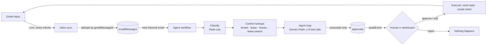

# FlowPilot AI

An email agent for property managers. It reads tenant emails, looks up the
tenant, unit and lease, drafts a reply and proposes repair tickets, and **waits
for a human to approve before anything is sent or created**.

Built with Next.js 16, Convex (Workflow, Workpool, vector search, crons), Convex
Auth, the Vercel AI SDK with Google Gemini, the Gmail API and shadcn/ui. Every
piece runs on a free tier.

- **Live demo:** [flow-pilot-rose.vercel.app](https://flow-pilot-rose.vercel.app): click **Try the demo** on the sign-in page. The demo account sees everything and can run the agent on simulated email; real email and uploads are owner-only.
- **Demo video (3 min):** _link_
- **Decisions log:** [docs/decisions.md](docs/decisions.md): one entry per technical choice, per stage

## What it does

1. A tenant emails the property manager's Gmail inbox.
2. A Convex cron pulls new mail every minute (Gmail history API, deduplicated by
   message id) and links the sender to a tenant.
3. Every new email starts a **durable agent run**: classify → look up tenant,
   lease, open tickets and the tenant's own lease PDF → draft a reply in the
   email's language, proposing a ticket for new repairs.
4. The run **pauses**. The manager approves, edits then approves, or rejects
   each proposal in the dashboard.
5. Approved replies are sent **in the same Gmail thread**; approved tickets are
   created. Rejected ones do nothing.

Everything is live in the dashboard: inbox, approvals queue with a pending
count, a step-by-step run timeline (inputs, outputs, retries, tokens, cost),
properties, CSV imports and lease documents.

The public landing page (`/`) shows the agent at work: as you scroll, four
real kinds of tenant email (repair, lease question, gas emergency, unknown
sender) type themselves out and the agent's steps appear one by one.

## Architecture



- **Convex Workflow**: one workflow per email; every LLM call and tool call is a
  journaled step, so a failure retries only that step. The approval wait is an
  event (`awaitEvent`), so a run can sleep for hours at no cost.
- **Convex Workpool**: background queues for 10,000-row CSV imports (100-row
  batches) and PDF processing (one job per file).
- **Vector search**: lease PDFs → unpdf → sentence-aware chunks → Gemini
  embeddings (768 dims). The index is filtered by tenant, so a search can only
  ever return the sender's own lease.
- **Live UI**: every page is a Convex subscription; there is no polling code.

## Guarantees enforced in code

| Guarantee | How |
|---|---|
| Nothing is sent or created without approval | Side-effect tools only write approval rows; execution runs after a row is approved |
| Tenant data only goes to that tenant | Tools never take a tenant id from the model; they are bound to the sender. Unknown senders get nothing |
| Bounded cost | At most 8 tool calls and 40k tokens per run, otherwise escalate to a person |
| Safe to retry | Imports, inbox sync, document processing and approvals are idempotent; sending mail is never retried blindly |
| Every input validated | Convex validators on every function, zod on every tool input, CSV row and form |
| Closed to strangers | Every query and mutation checks auth; email HTML is never rendered |

## Evaluation

30 tenant emails in English, German, French and Arabic: repairs (with and
without an existing ticket), lease questions answerable only from the tenant's
own lease, payments, moving, complaints, a gas emergency, a legal threat, and
three unknown senders trying to get tenant data. Each case defines the expected
category, action, reply language, facts the reply must contain and data it must
never contain. `npm run eval` runs them through the real pipeline and scores
them.

<!-- EVAL:START -->
Eval run 2026-10-20 · 32 emails · model `gemini-3.8-flash` · prompt `agent-v5`

| Metric | Result |
|---|---|
| All checks passed | 97% (31/32) |
| Category | 100% (32/32) |
| Action (reply / reply + ticket / escalate) | 97% (31/32) |
| Reply language = email language | 100% (32/32) |
| Facts from the lease in the reply | 100% (14/14) |
| Privacy (no data leaked to unknown senders) | 100% (3/3) |
| Urgency (safety cases) | 100% (3/3) |
| Time to draft, p50 / p95 | 11.8s / 29.7s |
| Cost per run (paid-tier prices) | $0.0019 |
| Step retries | 40 |

Failed cases:

- `complaint-service-en`: action escalate ≠ reply
<!-- EVAL:END -->

Full per-case results: [evals/results/latest.json](evals/results/latest.json).
Cases: [evals/emails.json](evals/emails.json).

## Data model

Convex tables in three groups. Every lookup goes through an index.

| Group | Tables |
|---|---|
| Property data | `buildings`, `units`, `tenants`, `leases`, `tickets` |
| Documents | `documents`, `docChunks` (vector index, filtered by `tenantId`) |
| Email & agent | `gmailAccounts` (encrypted tokens), `oauthStates`, `emailThreads`, `emailMessages`, `agentRuns`, `agentSteps`, `approvals` |
| Background jobs | `importJobs`, `importRowErrors` |

Natural keys (building name, building + unit label, tenant email, Gmail message
id) make imports and syncs safe to run twice.

## Run locally

```bash
npm install
npx convex dev                    # log in, create a dev deployment, push functions
npm run dev                       # http://localhost:3000
npx convex run seed:run           # 3 buildings, 60 units/tenants/leases (idempotent)
npm run generate:lease-pdfs       # lease PDFs to upload on /documents
```

Environment variables on the Convex deployment (never in the repo):

| Variable | For |
|---|---|
| `JWT_PRIVATE_KEY`, `JWKS`, `SITE_URL` | Convex Auth ([setup](https://labs.convex.dev/auth/setup/manual)) |
| `GOOGLE_GENERATIVE_AI_API_KEY` | Gemini (LLM and embeddings) |
| `GOOGLE_OAUTH_CLIENT_ID`, `GOOGLE_OAUTH_CLIENT_SECRET` | Gmail OAuth (redirect URI `https://<deployment>.convex.site/gmail/oauth/callback`, scope `gmail.modify`) |
| `TOKEN_ENCRYPTION_KEY` | 32 random bytes, base64: encrypts Gmail tokens at rest |
| `ALLOWED_SIGNUP_EMAILS` | Comma-separated emails allowed to create an account (unset: anyone) |
| `OWNER_EMAILS` | Comma-separated owner emails; everyone else is a demo user who can only act on simulated email (unset: everyone is an owner) |

On Vercel: `CONVEX_DEPLOY_KEY` (the build runs `npx convex deploy`), and
optionally `NEXT_PUBLIC_DEMO_EMAIL` / `NEXT_PUBLIC_DEMO_PASSWORD` for the
"Try the demo" button on the sign-in page (a demo-role account).

## Tests

```bash
npm test          # Vitest + convex-test: imports, dedupe, documents, inbox, agent, approvals, eval scoring
npm run eval      # the 30-email eval against the real model
```

Agent tests drive the real workflow with a scripted mock model, covering
retries, the fallback model, tool limits, the token cap, privacy and every
approval path, without calling Gemini.

## Project structure

```
convex/            backend: schema, functions, workflow, crons, HTTP routes
  model/           plain logic: upserts, chunking, embeddings, Gmail client, MIME, tool registry
  prompts/         versioned prompts
src/app/           Next.js routes: landing (/), sign-in, and the dashboard (inbox, approvals,
                   run timeline, properties, imports, documents)
src/components/    UI components (shadcn/ui in components/ui, landing/ for the landing page)
public/landing/    app screenshots used on the landing page (demo data only)
evals/             eval cases, scorer, results
scripts/           test data generators and the eval runner
docs/              decisions log, demo script
```

## Limitations and next steps

- Gmail's OAuth app is in testing mode, so the connection expires after about 7
  days ("Reconnect Gmail"). A verified app removes that.
- Polling every minute instead of Gmail push notifications (Pub/Sub).
- One property manager, one company: multi-tenant accounts are out of scope.
- Free-tier Gemini is rate-limited; runs slow down under load but finish.
